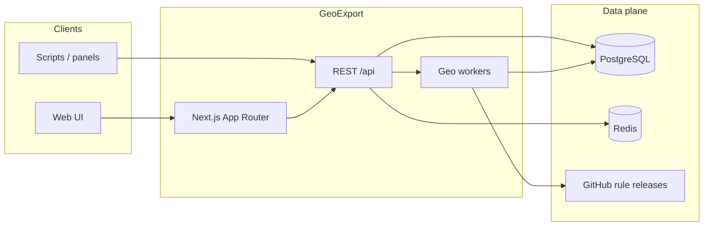

# Architecture

GeoExport is a full-stack web application for browsing geoip/geosite rule catalogs, exporting plain-text lists, and generating client routing snippets. This document describes the **target** architecture for `geoexport-premium` and how it relates to the existing static mirror.

## Goals

1. **Self-hosted** — operators run their own instance; no mandatory third-party backend.
2. **API-first** — every UI action has a REST equivalent for scripts and panels.
3. **Fast catalog UX** — presets and sources are served from cache/DB, not parsed on each page view.
4. **Heavy work off the hot path** — `.dat` ingestion and DNS resolution run in workers or upstream services.

## System context



## Layers

### Presentation (`src/app`, `src/components`)

- **Next.js App Router** — server components for catalog pages; client components for search, export, DNS lookup, routing builder.
- **Tailwind CSS 4** + **shadcn/ui** — design system aligned with Linear/Vercel density.
- **Framer Motion** — transitions for panels, modals, and theme toggle.

### API (`src/app/api` — planned)

Route handlers mirror the public contract documented in [API.md](./API.md):

| Concern | Implementation |
|---------|----------------|
| Catalog | Read presets/sources from PostgreSQL or baked JSON during bootstrap |
| Search | Redis-backed index or PostgreSQL full-text |
| Export | Stream plain text from resolved category lists |
| Lookup | DNS resolver + geodb membership check |
| Routing | Template engine for Xray / Mihomo / Sing-box snippets |

During migration, some routes may **proxy** to `GEOEXPORT_UPSTREAM` (default `https://geoexport.org`), matching behavior in [Domain_web](https://github.com/andrey271192/Domain_web) `server.mjs`.

### Data (`prisma/` — planned)

| Model area | Purpose |
|------------|---------|
| `Source` | Rule repo metadata (slug, URLs, compatibility) |
| `PresetGroup` / `Service` | Curated UI presets |
| `Category` | geoip:/geosite: entries per source |
| `RoutingPreset` | Saved routing templates |
| `UpdateJob` | Refresh status for `.dat` pulls |

### Cache (`redis`)

- Catalog responses (`presets`, `sources`, `last-update`)
- Search result pages
- Rate limiting counters for public API

### Workers (planned)

Background jobs:

1. Download `geoip.dat` / `geosite.dat` from configured GitHub releases.
2. Parse and upsert category index into PostgreSQL.
3. Expose progress via `GET /api/update/status`.

## Deployment topologies

### A — Single VPS (Docker Compose)

`web` + `postgres` + `redis` on one host. nginx terminates TLS and proxies to port 3000.

### B — Split managed

- Next.js on Vercel / Cloudflare Pages
- Neon / RDS for PostgreSQL
- Upstash for Redis

### C — Mirror-only (legacy)

[Domain_web](https://github.com/andrey271192/Domain_web): static SPA + Node proxy on port 4173. No PostgreSQL. Suitable until the Next.js port is feature-complete.

## Repository layout (target)

```
geoexport-premium/
├── src/
│   ├── app/                 # routes, layouts, API handlers
│   ├── components/          # UI primitives (shadcn)
│   └── lib/                 # db, redis, geo parsers
├── prisma/
│   └── schema.prisma
├── public/
├── docs/
├── docker-compose.yml
├── Dockerfile
└── .env.example
```

## Compatibility matrix

| Client | Import format | Notes |
|--------|---------------|-------|
| Xray | geoip.dat, geosite.dat, routing rules | Primary target |
| 3x-ui | Same as Xray | Panel import |
| V2Ray | `.dat` lists | v2fly source |
| Mihomo | YAML routing | Generator output |
| Sing-box | JSON / rule-set | Generator output |

## Security boundaries

- Public read APIs are unauthenticated by default; operators should place GeoExport behind VPN or enable API keys (roadmap).
- DNS lookup must be rate-limited to prevent abuse as an open resolver.
- Upstream proxy mode forwards only whitelisted `/api/*` paths — never arbitrary SSRF targets.

## Evolution from Domain_web

| Domain_web | geoexport-premium |
|------------|-------------------|
| Static `index.html` + `server.mjs` | Next.js SSR/ISR |
| JSON files in `data/` | PostgreSQL + optional JSON seed |
| Proxied dynamic API | Native handlers + workers |
| systemd + nginx install script | Docker Compose + generic reverse proxy |
